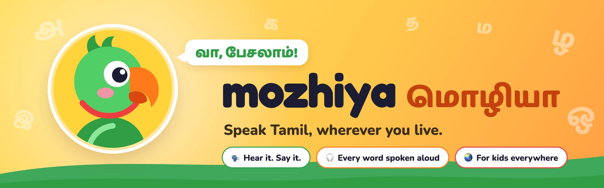

  

<h3 align="center">Free Tamil practice for children, made for families who live far from Tamil Nadu.</h3>

  <a href="https://mozhiya.com"><b>🌐 mozhiya.com</b></a> &nbsp;·&nbsp;
  <a href="https://mozhiya.com/oral-report">📝 Free oral report</a> &nbsp;·&nbsp;
  <a href="mailto:mozhiya.hq@gmail.com">✉️ mozhiya.hq@gmail.com</a>

---

### 🦜 Hi, we're Mozhiya

Many Tamil children abroad understand Paati on the phone but answer her in English. Their parents want to help but don't always feel confident in Tamil themselves.

**Mozhiya** is a friendly place to practise. Every Tamil word on the site is **spoken aloud**, children can **say it back**, and **Kili the parrot** (கிளி) keeps it fun. In Tamil stories the parrot is the bird that listens and repeats, which is exactly how children learn a language.

### ✨ What's inside

| | |
|---|---|
| 🔤 **[Letter trainer](https://mozhiya.com/learn/tamil-letters)** | All 247 letters with sound, then a listen-and-pick quiz |
| 🎮 **[Word game](https://mozhiya.com/learn/word-game)** | See a picture, pick the word, or hear a word and pick the picture |
| 🗣️ **[Speak and check](https://mozhiya.com/learn/speak-and-check)** | Your child says a word out loud and the browser checks it (nothing is recorded) |
| 🖨️ **[Printable tests](https://mozhiya.com/learn/printable-tests)** | Trace letters, fill in the gaps, match pictures: print or save as PDF |
| 📖 **[Stories](https://mozhiya.com/learn/stories)** | Original stories read aloud line by line, with English meanings |
| 👵 **[Talk to Paati](https://mozhiya.com/us/talk-to-paati)** | Paati asks, your child answers out loud: video calls, dinner, school |
| 🇸🇬 **[PSLE-style oral practice](https://mozhiya.com/sg/oral-practice)** | Picture-conversation scenes with examiner questions read aloud and a timer |
| 🏛️ **[Tamil history for kids](https://mozhiya.com/history)** | [Thiruvalluvar](https://mozhiya.com/history/thiruvalluvar), [Keezhadi](https://mozhiya.com/history/keezhadi), the palm-leaf books and more, with sources |

### 🌏 Where we help

**🇸🇬 Singapore** · **🇺🇸 USA** · **🇬🇧 UK** · **🇨🇦 Canada** · **🇦🇺 Australia** · **🇲🇾 Malaysia**

### 💛 Our promises

- **Free** to use: no accounts, no ads.
- **Parents only:** we talk to parents, never to children, and we never keep a child's voice.
- **Honest:** we cite our sources, and we never promise marks.

வா, பேசலாம்! &nbsp;·&nbsp; Come, let's talk!

